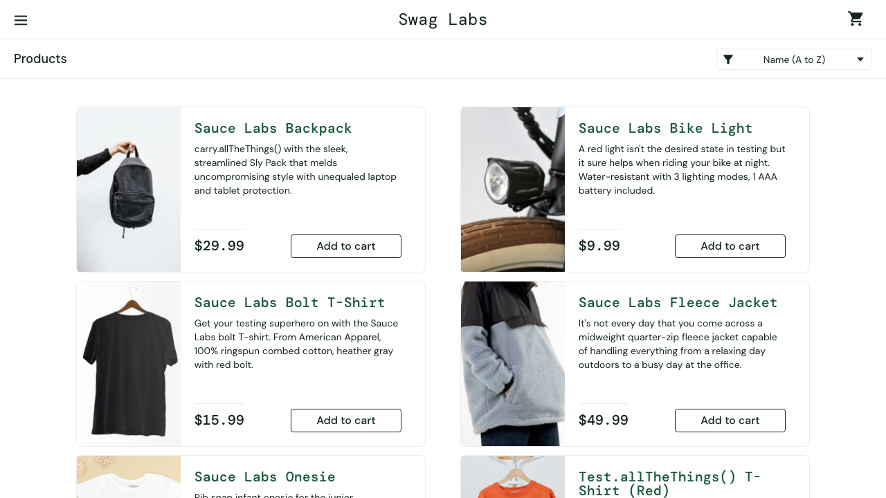

# Ecommerce QA Automation

Playwright-based end-to-end test automation for the SauceDemo ecommerce application. The suite covers login, product listing and sorting, cart behavior, and checkout flows using reusable page objects.

## Tech Stack

- Playwright Test
- TypeScript
- SauceDemo

## Getting Started

Install dependencies:

```bash
npm install
```

Run the test suite:

```bash
npx playwright test
```

Open the HTML report:

```bash
npx playwright show-report
```

## Failure Analysis and Debugging

To validate failure reporting, I intentionally modified a Playwright assertion in the login test and ran the scenario:

**Test scenario:** `standard user can log in successfully` in `tests/login.spec.ts`.

**Expected result:** After a successful login, the test should verify that the `Products` heading is visible.

**Actual result:** The assertion was temporarily changed to look for `This text does not exist`. The login itself completed and the inventory page loaded, but the requested text was not present, so the test failed.

**Failure analysis:** Playwright reported that `expect(locator).toBeVisible()` failed because `getByText('This text does not exist')` could not find an element within the timeout. The failure output identified the exact assertion and source line, making the expected-versus-actual mismatch straightforward to diagnose. The failure screenshot is included below.



This was a deliberately simulated test failure for validation and debugging practice, not a genuine application defect. The intended assertion is:

```ts
await expect(page.getByText('Products')).toBeVisible();
```
